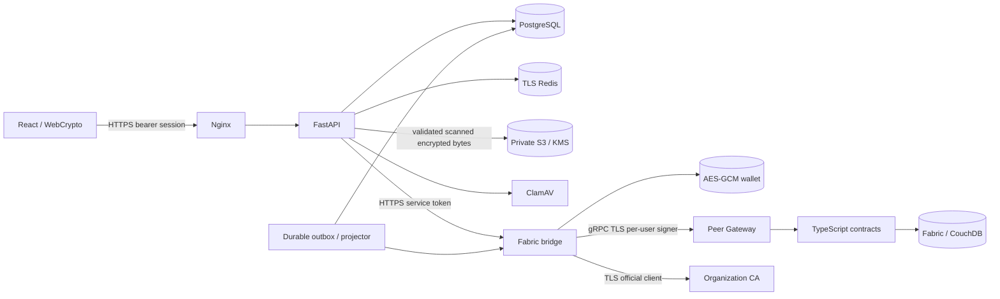
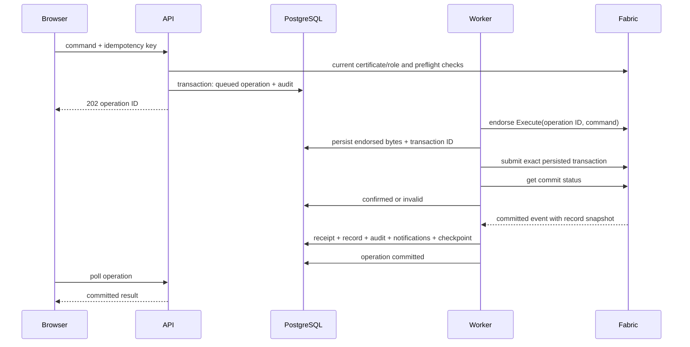

# Architecture

## Components and trust boundaries

The Python service is a modular monolith with a separate Node Fabric bridge. `main.py` owns HTTP routing, correlation IDs, rate limiting, tenant reads and demo isolation. `production.py` owns proof of possession, enrollment, encrypted profiles, durable command admission, evidence and signed credentials. `security.py` loads current ledger authorization for each production request; JWT roles are never accepted as authority. `adapters.py` configures PostgreSQL-adjacent dependency clients, TLS, bounded timeouts, Redis atomic limits, S3 and ClamAV. `models.py` and `migrations/` define the operational repository. `worker.py` submits the outbox and projects events.

The bridge is a trusted custodian of signing keys. It is not an untrusted relay or noncustodial wallet. Browser login proves possession of the same enrolled P-256 key. Keys are retained encrypted for authorized server-side Gateway submission. A bridge compromise can sign as its stored identities; organization endorsement and chaincode constraints limit business actions, but do not eliminate this trust boundary.

## Command consistency

There is no distributed PostgreSQL/Fabric transaction. `confirmed` means the peer reported a valid commit; `committed` is published to the UI after the event has been projected. A timed-out submit is `uncertain`. Retries reuse endorsed bytes and the same Fabric transaction ID. A ledger operation key also prevents logical replay. Unknown outcomes never update ownership optimistically. Ten failed processing attempts require operator attention; committed events can still resolve an uncertain operation later.

Within a chaincode proposal, the shared write helper retains staged bytes on the transaction context so subsequent dispatch/result/event reads see the intended mutation. Fabric getState itself returns committed world state. The before-transaction hook clears this map on every invocation, and the peer still performs all state reads/writes, endorsement and MVCC validation. The map is a proposal-local consistency mechanism and cannot serve requests during ledger failure.

## Projection and events

Gateway event requests resume using both a block and transaction checkpoint. PostgreSQL receipts deduplicate transaction IDs. The record, event, notification, operation result and cursor commit together. Projections are rebuildable business indexes, while evidence, profiles and signed document objects have independent recovery requirements. Direct contract calls emit projection snapshots as well, but only `Operations.Execute` carries an API operation ID. Failed endorsement cannot persist a chaincode denial; API denials are recorded separately.

One worker is elected using a PostgreSQL session advisory lock. This deliberately bounds write throughput and preserves event ordering. Scale API/UI replicas independently; shard the worker only after measuring throughput and introducing explicit partition ownership. Dependency health includes a worker heartbeat; an idle or stalled projector cannot leave readiness permanently green.

## Tenancy and privacy

Org1MSP and Org2MSP are the only trusted channel organizations. Every API query scopes organization or an explicit pending transfer recipient. Chaincode independently binds MSP, certificate digest, CA DID attribute, active status and role. Cross-organization transfers require source-owner request, destination-recipient acceptance and a separate source approver. Final ownership moves the asset organization. Sensitive evidence stays with the original off-chain organization and does not automatically migrate; transfer disclosure requires a separately authorized evidence workflow.

No raw files, profile fields, secrets or signed credential documents enter the channel. Ledger identifiers remain linkable pseudonyms rather than anonymous values. See DATA_BOUNDARIES.md and the ADRs for deliberate limits.
