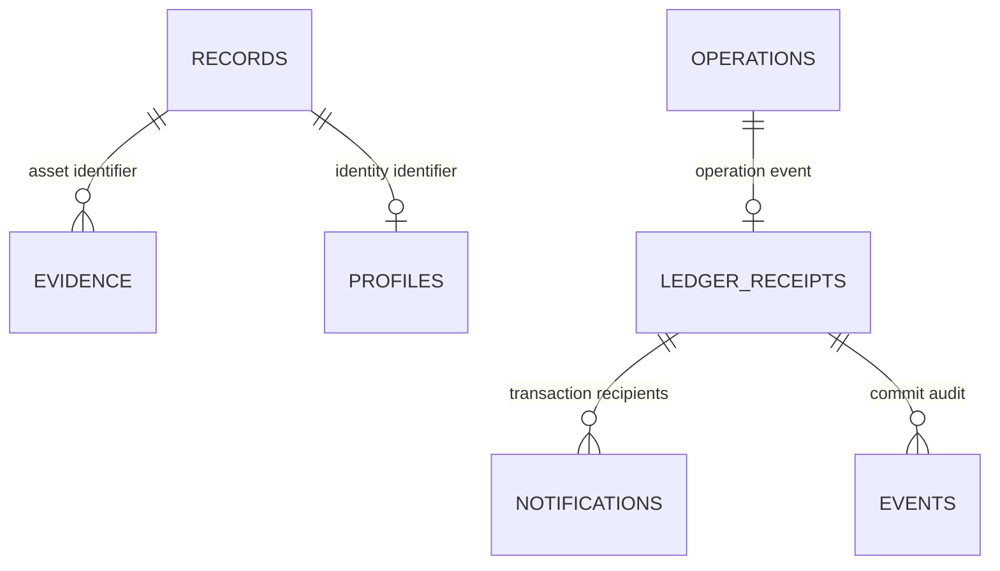

# Data model

PostgreSQL stores off-chain operational state; Fabric owns identity, credential and asset authority. SQLAlchemy JSON maps to PostgreSQL JSONB in migrations. The SQLite demo is an isolated fixture store and has no claim to PostgreSQL locking or ledger durability.

## Tables

| Table | Fields and constraints | Ownership / purpose |
|---|---|---|
| `records` | `id varchar(160)` PK; `org`, `kind`, JSONB `body`, integer `version`; `(org,kind)` index | Rebuildable identity/asset/credential/proposal/organization/evidence projection. IDs are globally unique across ledger namespaces. |
| `events` | bigserial `sequence` PK; `org`, `actor`, `action`, `subject`, `outcome`, `correlation`, `created_at`, `source`; `(org,sequence)` index | Tenant audit. SQL trigger rejects UPDATE/DELETE; application role has no DELETE grant. |
| `idempotency` | serial PK; `actor`, `key`, SHA-256 `digest`, JSONB `response`; unique `(actor,key)` | Demo request replay only. Production uses operations. |
| `operations` | UUID-string PK; `actor`, `org`, request `key`, canonical digest, command JSONB, `status`, endorsed/commit JSONB `prepared`, JSONB `result`, attempts, creation time; unique `(actor,key)`; pending/status/time and org indexes | Durable production command outbox. Endorsed bytes are operationally sensitive and retained for reconciliation. |
| `ledger_receipts` | Fabric `tx` PK, decimal-string block, event JSONB, timestamp | Idempotent event delivery. Append-only trigger. |
| `checkpoints` | `id` PK, decimal-string `block`, optional transaction ID | `aegis` event cursor; `worker` heartbeat uses epoch seconds in the block field. |
| `evidence` | ID PK (64 chars), org, actor, asset/credential ID, SHA-256, unique object key, type, positive byte size, timestamp; org/asset index | Private S3 document index. Signed VC documents use `application/vc+jwt`; other evidence is PDF/PNG/JPEG. |
| `notifications` | `(transaction:recipient)` string PK, org, actor, JSONB body, time; org/actor/time index | Durable in-app notifications delivered by the projector. |
| `profiles` | DID PK, organization index, encrypted JSONB envelope | Own-identity profile; AES-GCM nonce and ciphertext, AAD binds org and DID. |
| `schema_migrations`, `migration_checksums` | migration number PK, applied timestamp; SHA-256 per version | Ordered DDL with advisory locking and checksum drift detection. |

These relationships are logical rather than foreign keys: evidence can be indexed before the ledger commit, revoked identities remain historical references, and projection rebuilds must not delete private operational data. Application and chaincode validate references; unique IDs, actor/key constraints and ledger MVCC protect concurrent writes. PostgreSQL read models must never authorize a production command on their own.

## Ledger bodies

Identity: `id`, `org`, certificate SHA-256 `binding`, active/suspended/revoked `status`, fixed-policy role names. Asset: `id`, `org`, issuer, nullable owner, metadataHash, minted/active/archived status, timestamps, optional pending recipient/recipientOrg/requester/expiry/approver/acceptance. Credential: ID, org, issuer, subject, signed-document digest, active/revoked state and creation time. Proposal: ID, org, requester, target, permitted action/value, expiry, pending/approved state. Organization: MSP, mandatory approval policy, configurable transferTTL and version. Evidence: ID, org, parent asset, digest and anchored state.

`Record.body.metadata_hash` normalizes ledger `metadataHash` for the UI. Credential `subject` is also projected as `owner`. Asset history is a bounded latest-200 projection; full historical investigation uses Fabric `AuditRegistry.Provenance` and receipts. Neither projection `version` nor SQL sequence is a blockchain block number.

## Migrations and retention

Run `python -m app.migrate` from backend with the migration owner credential; application startup does not issue DDL. Migration files become immutable after application. Existing version-1 databases acquire a checksum baseline when first upgraded. Back up before applying version 2. Do not use `Base.metadata.create_all` for production.

Keep operation IDs and ledger replay records indefinitely unless governance explicitly defines replay-safe pruning. Profiles and objects have organizational retention and deletion policies; channel pseudonyms/commitments persist with ledger history. Audit retention is append-only by default; archival/deletion requires a separately audited owner-operated procedure, not application credentials.
